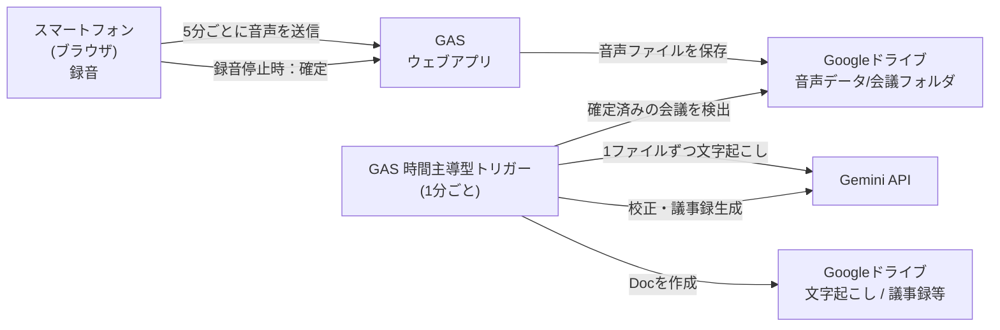

# らくらく議事録

会議をスマートフォンで録音するだけで、**文字起こし・議事録の作成・Googleドライブへの保存**までを自動で行う Web アプリです。
介護施設での会議（生産性向上委員会、サービス担当者会議、苦情・要望の受付など）で使うことを想定して作られています。

> 開発：Effortless Care DX
> © 2026 Effortless Care DX

---

## 特長

- **録音を止めたら、アプリを閉じてよい**
  録音停止後は音声の保存を確定するだけです。文字起こし・議事録の作成は、Google Apps Script（GAS）のトリガーがバックグラウンドで自動処理します。
- **長時間の会議に対応**
  録音を一定時間（既定は5分）ごとのファイルに分けて、Googleドライブへ順に保存します。30分〜数時間の会議でも、GAS の実行時間制限（6分）を超えないよう、ファイルを1件ずつ処理して進捗を保存し、次回の実行へ引き継ぎます。
- **用途別の議事録テンプレートを3種類用意**
  汎用議事録 / サービス担当者会議録（第4表） / 苦情・要望等受付
- **途中で止まっても再開できる**
  進捗は `_progress.json` に保存されるため、時間切れや通信エラーがあっても、続きから処理されます。
- **スマートフォンでの長時間録音を支える仕組み**
  画面スリープの防止（Wake Lock）、録音中の暗色表示と疑似スリープ表示、マイク音声の前処理（低周波ノイズの除去・音量差の圧縮）を備えています。
- **診断情報の表示**
  通信エラーや処理結果（finishReason・トークン数など）をアプリ内で確認し、コピーして共有できます。

---

## 全体の仕組み



### 処理の流れ

1. **録音**：ブラウザで録音し、一定時間ごとに区切って、GAS 経由でドライブの会議フォルダへ保存します（`01_音声.webm`、`02_音声.webm` …）。
2. **確定**：録音を停止すると、フロントが「録音完了」をGASに通知します。会議フォルダに録音完了フラグが立ちます。
3. **自動処理**：トリガーが1分ごとに起動し、録音が完了した未処理の会議フォルダを古い順に1件選びます。
   1. 音声ファイルを1件ずつ Gemini にアップロードして文字起こしし、`_progress.json` に保存する
   2. 全ファイルが終わったら、結果を結合して校正する（誤認識の補正、話者ラベルの統合）
   3. 選択されたテンプレートで議事録を生成する
   4. 文字起こしと議事録の Google ドキュメントを作成する
   5. 会議フォルダ名の先頭に `【済】` を付ける
4. **確認**：数分後、ドライブの `議事録等` フォルダに議事録が作成されています。

> 録音完了の通知（`finalizeAudio`）が届かなかった場合に備え、**最後のファイルが保存されてから20分経過した会議フォルダ**は、完了済みとして処理対象になります。

---

## ファイル構成

```
.
├── index.html                      # 画面（UI・録音・疑似スリープ・お助けモード）
├── js/
│   └── recorder-controller.js      # ミドルエンド（GASへの送信、同時実行数の制限、リトライ、診断ログ）
├── img/
│   └── logo_icon.png               # ヘッダーのロゴ
└── gas/
    ├── コード.gs                    # GAS バックエンド（保存・文字起こし・議事録生成・トリガー）
    └── （プロンプトのファイル）       # PROMPT_TEMPLATES を定義した別ファイル
```

- `gas/` 配下は、GAS のスクリプトエディタに貼り付けるファイルです（リポジトリにはバックアップとして置きます）。
- プロンプトのファイル名は任意です。`PROMPT_TEMPLATES` という定数が、同じ GAS プロジェクト内に存在していれば動作します。

---

## Googleドライブのフォルダ構成

`DRIVE_FOLDER_ID` で指定したフォルダ（未設定の場合は、マイドライブ直下の「レコーダー」）の下に、次のフォルダが自動で作られます。

```
レコーダー/
├── 音声データ/
│   └── 20261017_会議名/        # 録音1回につき1フォルダ
│       ├── 01_音声.webm
│       ├── 02_音声.webm
│       └── _progress.json      # 処理中のみ存在（完了すると削除）
├── 文字起こし/                   # 文字起こしの Google ドキュメント
├── 議事録等/                     # 議事録の Google ドキュメント
└── _一時録音中/
```

- 会議フォルダ名は `録音日（yyyyMMdd）_会議名` です。
- 処理が完了した会議フォルダには、`【済】` が先頭に付きます。
- ドキュメント名の日付も、処理した日ではなく**録音日**です。

---

## セットアップ

### 1. GAS（バックエンド）

1. [Google Apps Script](https://script.google.com/) で新しいプロジェクトを作成する
2. `コード.gs` と、プロンプトのファイルを貼り付ける
3. 「プロジェクトの設定」→「スクリプト プロパティ」に、次の値を登録する

   | プロパティ | 必須 | 内容 |
   |---|---|---|
   | `GEMINI_API_KEY` | ○ | Gemini API のキー |
   | `DRIVE_FOLDER_ID` | | 「レコーダー」フォルダ自体の ID。未設定ならマイドライブ直下の「レコーダー」を使う |
   | `TRANSCRIBE_MODEL` | | 文字起こしに使うモデル（既定：`gemini-3.8-flash`）。`-transcribe` を含む名前のモデルは、Interactions API で処理される |
   | `MINUTES_MODEL` | | 校正・議事録生成に使うモデル（既定：`gemini-3.8-flash`） |
   | `DOMAIN_CONTEXT` | | 会議の分野を表す語句（既定：`業務`）。例：`介護施設` |
   | `DOMAIN_TERM_HINTS` | | 専門用語・固有名詞のヒント（カンマ区切り）。誤認識の補正と、議事録の表記統一に使われる |

4. 「デプロイ」→「新しいデプロイ」→ 種類「ウェブアプリ」で公開し、**ウェブアプリのURL**を控える
   - 次のユーザーとして実行：自分
   - アクセスできるユーザー：運用に合わせて設定（注意事項を参照）
5. スクリプトエディタで `setupQueueTrigger` を一度だけ実行する（1分ごとのトリガーが登録されます）
   - 停止したい場合は `removeQueueTrigger` を実行します。

> `コード.gs` や `PROMPT_TEMPLATES` を修正した場合、**ウェブアプリは新しいバージョンとして再デプロイ**してください（フロントから呼ぶ処理に必要です）。トリガー側は、保存すれば反映されます。

### 2. フロント（画面）

1. `index.html`、`js/`、`img/` を、静的ホスティング（GitHub Pages など）に配置する
2. スマートフォンのブラウザで開き、右上の「⋮」→「設定」で、**GAS のウェブアプリURL**を登録する

> 配信側で `js/recorder-controller.js` を更新した後は、`index.html` 内の `?v=` の番号も上げてください（ブラウザのキャッシュ対策）。

### 動作環境

- マイクの利用に **HTTPS** が必要です（GitHub Pages なら標準で対応）
- 録音・画面スリープ防止には、`MediaRecorder` と Wake Lock API に対応したブラウザが必要です（Android の Chrome を想定）
- 録音中は、画面を表示したまま、他のアプリへの切り替えや画面ロックを避けてください

---

## 使い方

1. 「会議名・内容」を入力する（🎙️ボタンで音声入力も可能）
2. 「議事録テンプレート」を選ぶ
3. 🎤 ボタンをタップして録音を開始する
4. 会議が終わったら、⏹ ボタンをタップする
5. 「音声データの確認が完了しました」と表示されたら、アプリを閉じてよい
6. 数分後、ドライブの `議事録等` フォルダで議事録を確認する

録音の間隔が空いた場合（長い会議）は、処理に時間がかかります。目安として、30分の会議で数分〜10数分です。

### 議事録テンプレート

| テンプレート | 用途 | 出力の特徴 |
|---|---|---|
| 汎用議事録 | 一般的な会議 | 冒頭の「今回の要点」（決定・継続協議）、議題ごとの結論と経緯、アクションアイテム表 |
| サービス担当者会議録 | サービス担当者会議（第4表） | 第4表の欄（出席者・検討した項目・検討内容・結論・残された課題）に沿った出力。介護ソフトへの転記を想定 |
| 苦情・要望等受付 | 苦情・相談の受付 | 受付書の様式に沿った出力。法人様式への転記用の下書き |

- 文字起こしから確認できない項目は、推測せず `[要確認]` と出力されます。
- 出力はあくまで**原案**です。内容は必ず人が確認・修正してください。
- テンプレートの内容は、`PROMPT_TEMPLATES`（プロンプトのファイル）を編集すれば変更できます。

---

## お助けモード・診断情報

画面右上の「⋮」メニューから開きます。

- **手動再開（お助けモード）**：録音後の確定保存に失敗した場合などに、保存済みの音声を確定し、バックグラウンド処理を開始します。
- **診断情報**：通信エラーの詳細や処理結果を表示し、コピーできます。不具合の連絡時に、このテキストを共有してください。
- **設定**：GAS のウェブアプリURLを登録します。

---

## 主な設定値

| 場所 | 項目 | 既定値 | 内容 |
|---|---|---|---|
| `index.html` | `SEGMENT_INTERVAL_MS` | 300000（5分） | 録音を区切る間隔。短いほど、アプリが落ちたときに失われる音声が減るが、ファイル数が増え、ファイルごとに話者ラベルが振り直される |
| `index.html` | `PSEUDO_SLEEP_DELAY_MS` | 15000（15秒） | 操作がないまま経過すると、疑似スリープ表示になるまでの時間 |
| `recorder-controller.js` | `MAX_RETRIES` | 3 | 通信失敗時の再送回数 |
| `recorder-controller.js` | `MAX_CONCURRENT_REQUESTS` | 2 | GAS への同時リクエスト数の上限 |
| `コード.gs` | `TIME_LIMIT_MS` | 210000（3分30秒） | 1回の実行で文字起こしに使う時間の上限。超えた分は次回のトリガーに引き継ぐ |
| `コード.gs` | `MAX_BACKGROUND_PROCESSING_RETRIES` | 3 | エラーで失敗した場合の自動再試行の上限。超えると、その会議は自動処理の対象から外れる |
| `コード.gs` | `MAX_EMPTY_RESULT_RETRIES` | 3 | 文字起こしの結果が空だったファイルの再試行回数。超えると「無音」として空のまま確定する |
| `コード.gs` | `IDLE_FALLBACK_MS` | 20分 | 録音完了の通知がなくても、最後のファイルからこの時間が経つと処理対象になる |

---

## 処理のやり直し・トラブルシューティング

### 議事録が作られない

1. ドライブの会議フォルダに、`【済】` が付いていないか確認する
2. GAS の「実行数」で、`processQueueTrigger` の実行ログを確認する（長時間かかった実行が、文字起こしを行った実行）
3. GAS のスクリプトエディタで `debugCheckSessionFailCounts` を実行すると、各会議フォルダの状態（ファイル数、失敗回数、録音完了の有無）がログに出力される
4. 失敗回数が上限（3回）に達している場合、自動処理の対象から外れています。原因を確認したうえで、下記の手順で再処理してください

### 同じ会議を、もう一度処理し直す

1. 会議フォルダ名から `【済】` を外す
2. `議事録等` フォルダにある、その会議の議事録ドキュメントを別の場所へ移す
   （同じ日付・会議名のファイルが `議事録等` にあると、「処理済み」と判定されます）
3. 重複を避けたい場合は、`文字起こし` フォルダの文字起こしドキュメントも移す
4. 失敗回数が上限に達していた場合は、会議フォルダの「説明」欄（`セッションID|テンプレート|失敗回数|録音完了`）の、**3番目の値（失敗回数）を `0`** に戻す
5. `_progress.json` が残っている場合は、削除すると、最初から処理し直される

### 録音の一部が抜けている

- 録音中に保存に失敗した区間があった場合、停止時に警告が表示されます。その区間は文字起こしされません。
- 音声そのものは、会議フォルダ内の各ファイルを再生して確認できます。

### 固有名詞が間違って出力される

- スクリプトプロパティ `DOMAIN_TERM_HINTS` に、施設名・職員名・システム名などを、カンマ区切りで登録してください。

---

## 注意事項

### セキュリティ・個人情報

- **音声データは、文字起こしのため Gemini API に送信されます。** 処理後、Gemini 側の一時ファイルは削除されますが、利用する施設・法人の個人情報の取り扱いや生成AIの利用に関する規程に沿って運用してください。
- **ウェブアプリには、認証機能がありません。** URL を知っている人は、誰でもアクセスできます。URL は関係者以外に共有しないでください。複数の施設へ提供する場合は、共有トークンによる認証などを追加することを推奨します。
- 汎用議事録のテンプレートでは、利用者や地域住民の個人名・住所を書かないよう指示しています。ただし、AI の出力を保証するものではないため、共有前に確認してください。

### 既知の制限

- 画面の「AI処理モード」の選択（①録音保存のみ／②文字起こしまで／③議事録生成まで）は、現在、バックグラウンド処理には反映されません。トリガーは常に③（議事録生成まで）で処理します。
- 録音中にアプリが強制終了した場合、直近の最大1区間（既定では5分）の音声は失われます。それまでに保存された分は、自動的に処理されます。
- 区間の境目（ファイルの切り替え時）に、ごく短い録音の欠けが出ることがあります。
- 文字起こしの話者分離は、ファイルごとに行われます。ファイルをまたいだ話者の統合は、校正の段階で AI が行うため、完全ではありません。
- AI が生成する文字起こしと議事録には、誤りや抜けが含まれることがあります。特に、数値・日付・人名・固有名詞は、必ず確認してください。

---

## ライセンス

[ライセンスを記載してください]

© 2026 Effortless Care DX
