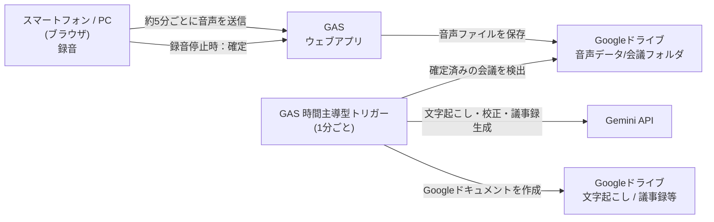

# らくらく議事録

会議をスマートフォンやパソコンのブラウザで録音するだけで、**文字起こし・議事録の作成・Googleドライブへの保存**までを自動で行う Web アプリです。
介護施設での会議（生産性向上委員会、サービス担当者会議、苦情・要望の受付など）で使うことを想定して作られています。

> 開発：Effortless Care DX
> © 2026 Effortless Care DX

---

## 特長

- **録音を止めたら、アプリを閉じてよい**
  録音停止後は音声の保存を確定するだけです。文字起こし・校正・議事録の作成は、Google Apps Script（GAS）のトリガーがバックグラウンドで自動処理します。
- **長時間の会議に対応**
  録音を約5分ごとのファイルに分けて、Googleドライブへ順に保存します。GAS の実行時間制限（6分）を超えないよう、文字起こし・校正・議事録作成の進み具合を保存しながら、次回のトリガー実行へ引き継ぎます。
- **会話の切れ目で区切る**
  4分45秒を過ぎたら、0.8秒以上の静かな瞬間を探して区切ります。見つからなければ5分30秒で区切ります。
- **マイクが止まっても気づける・失わない**
  他のアプリの表示中や画面ロック中は、端末の仕様でマイクが止まることがあります。止まったことを検知して画面と振動で知らせ、この画面に戻ると自動で録音を再開します。途切れた時間帯は、文字起こしと議事録の冒頭に注記として残ります。
- **録音データを端末内にも保存**
  音声を1秒ごとに端末内（IndexedDB）へ保存します。ブラウザが落ちた場合や通信できなかった場合も、次に開いたときに未送信分を自動でドライブへ送ります。
- **用途別の議事録テンプレートを3種類用意**
  汎用議事録 / サービス担当者会議録（第4表） / 苦情・要望等受付
- **パソコン向けの機能**
  Web会議（Zoom / Meet など）の相手の声を一緒に録音するモードと、使用するマイクの選択ができます。
- **診断情報の表示**
  通信エラー、マイクの停止・復旧、区間の区切り方などをアプリ内で確認し、コピーして共有できます。

---

## 全体の仕組み



### 処理の流れ

1. **録音**：ブラウザで録音し、約5分ごとに区切って、GAS 経由でドライブの会議フォルダへ保存します（`01_音声.webm`、`02_音声.webm` …。iPhone などでは `.mp4`）。
2. **確定**：録音を停止すると、フロントが「録音完了」を GAS に通知します。会議フォルダに録音完了フラグが立ちます。未送信の区間が残っている場合は確定を保留し、送信できた時点で自動的に確定します。
3. **自動処理**：トリガーが、録音が完了した未処理の会議フォルダを古い順に1件選び、次の順で処理します。
   1. 音声ファイルを1件ずつ Gemini にアップロードして文字起こしし、`_progress.json` に保存する
   2. 全ファイルが終わったら、結果を結合して校正する（誤認識の補正、話者ラベルの統合）
   3. 選択されたテンプレートで議事録を生成する
   4. 文字起こしと議事録の Google ドキュメントを作成する
   5. 会議フォルダ名の先頭に `【済】` を付ける
4. **確認**：数分後、ドライブの `議事録等` フォルダに議事録が作成されています。

> 録音完了の通知が届かなかった場合に備え、**最後のファイルが保存されてから20分経過した会議フォルダ**も処理対象になります。この場合、議事録の冒頭に「録音の終了操作が確認できませんでした」と注記されます。

### 時間制限への対応

GAS は1回の実行が6分までです。次の方法で、長い会議でも止まらないようにしています。

- 文字起こしは、開始から3分30秒を超えたら、残りのファイルを次回に回します。
- 校正は、1万2千字以下なら1回で行います。それより長い場合は約6千字ごとに分割し、1つ終わるごとに保存します。
- 校正が終わった時点で開始から3分20秒を超えていたら、議事録の生成は次回に回します。
- 時間切れで強制終了された実行は、次回の実行時に検知して失敗回数に数えます。同じ箇所で続けて止まる場合は、その部分の校正を省略して先へ進みます。

---

## ファイル構成

```
.
├── index.html                      # 画面（UI・録音・マイクの監視と自動再開・端末内保存）
├── js/
│   └── recorder-controller.js      # ミドルエンド（GASへの送信、同時実行数の制限、リトライ、診断ログ）
├── img/
│   └── logo_icon.png               # ヘッダーのロゴ
└── gas/
    ├── コード.gs                    # GAS バックエンド（保存・文字起こし・校正・議事録生成・トリガー）
    └── （プロンプトのファイル）       # PROMPT_TEMPLATES を定義した別ファイル
```

- `gas/` 配下は、GAS のスクリプトエディタに貼り付けるファイルです。フォルダ名は一例です。
- プロンプトのファイル名は任意です。`PROMPT_TEMPLATES` という定数が、同じ GAS プロジェクト内にあれば動作します。

---

## Googleドライブのフォルダ構成

`DRIVE_FOLDER_ID` で指定したフォルダ（未設定の場合は、マイドライブ直下の「レコーダー」）の下に、次のフォルダが自動で作られます。

```
レコーダー/
├── 音声データ/
│   ├── 20261117_会議名/              # 録音中〜処理待ち
│   │   ├── 01_音声.webm
│   │   ├── 02_音声.webm
│   │   ├── _progress.json            # 処理中の進み具合（完了後に削除）
│   │   └── _recording_notes.json     # 録音の途切れなどの記録（ある場合のみ）
│   └── 【済】20261117_会議名/        # 処理完了後
├── 文字起こし/                        # 文字起こしの Google ドキュメント
├── 議事録等/                          # 議事録の Google ドキュメント
└── _一時録音中/
```

- 会議フォルダ名は `録音日（yyyyMMdd）_会議名` です。録音中に会議名を変えた場合は、確定時にフォルダ名へ反映されます。
- ドキュメント名は `録音日_会議名_文字起こし`、`録音日_会議名_議事録` です。同じ名前のドキュメントがある場合は上書きします。
- 会議フォルダ内の、名前が `_` で始まるファイルは補助ファイルです。音声としては扱いません。

---

## セットアップ

### 1. GAS（バックエンド）

1. [Google Apps Script](https://script.google.com/) で新しいプロジェクトを作成する
2. `コード.gs` と、プロンプトのファイルを貼り付ける
3. 「プロジェクトの設定」→「スクリプト プロパティ」に、次の値を登録する

   | プロパティ | 必須 | 内容 |
   |---|---|---|
   | `GEMINI_API_KEY` | ○ | Gemini API のキー |
   | `DRIVE_FOLDER_ID` | | 「レコーダー」フォルダ自体の ID。未設定ならマイドライブ直下の「レコーダー」を使う |
   | `TRANSCRIBE_MODEL` | | 文字起こしに使うモデル名（既定：`gemini-3.8-flash`）。`-transcribe` を含む名前のモデルは、Interactions API で処理される |
   | `MINUTES_MODEL` | | 校正・議事録生成に使うモデル名（既定：`gemini-3.8-flash`） |
   | `DOMAIN_CONTEXT` | | 会議の分野を表す語句（既定：`業務`）。例：`介護施設` |
   | `DOMAIN_TERM_HINTS` | | 専門用語・固有名詞のヒント（カンマ区切り）。誤認識の補正と、議事録の表記統一に使われる |

4. 「デプロイ」→「新しいデプロイ」→ 種類「ウェブアプリ」で公開し、**ウェブアプリのURL**を控える
   - 次のユーザーとして実行：自分
   - アクセスできるユーザー：運用に合わせて設定（注意事項を参照）
5. スクリプトエディタで `setupQueueTrigger` を一度だけ実行する（1分ごとのトリガーが登録されます）
   - 停止したい場合は `removeQueueTrigger` を実行します。

> `コード.gs` やプロンプトを修正した場合、**ウェブアプリは新しいバージョンとして再デプロイ**してください。トリガー側は、保存すれば反映されます。

次のスクリプトプロパティは、アプリが自動で使います。手で編集する必要はありません。

| プロパティ | 内容 |
|---|---|
| `QUEUE_PENDING_AT` | 未処理の録音があることを示す目印 |
| `QUEUE_LAST_SCAN_AT` | 最後に全フォルダを確認した時刻 |
| `QUEUE_RUNNING_FOLDER` | 処理中のフォルダ（時間切れによる強制終了の検知に使う） |

### 2. フロント（画面）

1. `index.html`、`js/`、`img/` を、静的ホスティング（GitHub Pages など）に配置する
2. ブラウザで開き、右上のメニュー →「設定」で、**GAS のウェブアプリURL**を登録する

> `js/recorder-controller.js` を更新したときは、`index.html` 内の `?v=` の番号も上げてください（ブラウザのキャッシュ対策）。

### 動作環境

| 端末 | 推奨の開き方 |
|---|---|
| Android | Chrome（ホーム画面のショートカットでも可） |
| iPhone / iPad | **Safari でページを直接開く**。Chrome などの他のブラウザや、ホーム画面のアイコンから開くと、他のアプリの表示中にマイクが止まりやすくなります（その場合は画面に注意が表示されます） |
| パソコン | Chrome / Edge |

- マイクの利用に **HTTPS** が必要です（GitHub Pages なら標準で対応）。
- 端末内保存に IndexedDB を使います。プライベートブラウズなどで使えない場合は、メモリのみで動作します。

---

## 使い方

1. 「会議名・内容」を入力する（マイクのボタンで音声入力も可能。録音中は使えません）
2. 「議事録テンプレート」を選ぶ
3. 中央のボタンをタップして録音を開始する
4. 会議が終わったら、同じボタンをタップして停止する
5. 「音声データの確認が完了しました」と表示されたら、アプリを閉じてよい
6. 数分後、ドライブの `議事録等` フォルダで議事録を確認する

処理時間の目安は、30分の会議で数分〜10数分です。

### 録音中の画面

- 画面が暗い色に切り替わり、15秒操作がないと省電力表示（黒い画面）になります。タップすると戻ります。録音は続いています。
- 約5分ごとに音声がドライブへ保存され、保存の状況が丸印で表示されます（緑：保存済み、橙：失敗して再送待ち）。
- マイクが止まると「マイクが停止中」と点滅表示され、端末が振動します。この画面に戻るかタップすると、自動で録音を再開します。

### 録音中に他のアプリで資料を見るとき

他のアプリを表示している間は、端末の仕様でマイクが止まることがあります。完全に防ぐことはできませんが、次の方法で止まりにくくなります。確実な順に並べています。

1. **別の端末で資料を見る**（録音用と資料用で端末を分ける）
2. **画面分割を使う**（Android の分割画面、iPad の Split View）
3. **「小窓にして他のアプリを見る」を押してから、他のアプリを開く**
   録音中、ステータス表示の下にボタンが出ます。この画面が小さな窓として他のアプリの上に残り、経過時間とマイクの状態を表示します。対応していない端末ではボタンが出ません。

このほか、録音中は無音の音声を自動で再生し続けることで、端末に「再生中のページ」として扱わせています。通知欄に「録音中／らくらく議事録」と表示されるのはこのためです。

止まってしまった場合は、途切れた時間帯が停止時の案内と議事録の冒頭に表示されます。

### パソコンで使うとき

- **Web会議の音声も一緒に録音する**：チェックを入れて録音を始めると、画面やタブの共有を選ぶ画面が出ます。共有する対象を選び、「音声を共有」をオンにしてください。自分のマイクと相手の声を合わせて録音します。
- **使用するマイク**：マイクが複数ある場合、メニューの「設定」から選べます。選んだマイクが接続されていないときは、既定のマイクに自動で切り替わります。

### 議事録テンプレート

| テンプレート | 用途 | 出力の特徴 |
|---|---|---|
| 汎用議事録 | 一般的な会議 | 冒頭の「今回の要点」（決定・継続協議）、議題ごとの結論・指摘・経緯、アクションアイテム表 |
| サービス担当者会議録 | サービス担当者会議（第4表） | 第4表の欄（出席者・検討した項目・検討内容・結論・残された課題）に沿った出力。介護ソフトへの転記を想定 |
| 苦情・要望等受付 | 苦情・相談の受付 | 受付書の様式に沿った出力。法人様式への転記用の下書き |

- 文字起こしから確認できない項目は、推測せず `[要確認]` と出力されます。
- 出力はあくまで**原案**です。内容は必ず人が確認・修正してください。
- テンプレートの内容は、`PROMPT_TEMPLATES`（プロンプトのファイル）を編集すれば変更できます。

### 文書の冒頭に付く注記

次の場合、文字起こしと議事録の冒頭に「【録音に関する注記（自動記録）】」が付きます。この注記は AI を通さず、アプリがそのまま書き込みます。

- 録音が途切れた時間帯がある（録音開始からの経過時間と理由）
- 録音の終了操作が確認できなかった（アプリが途中で閉じられた場合など）
- 文字起こしが途中で打ち切られた可能性がある区間がある

---

## メニュー（右上）

- **手動再開**：録音後の確定に失敗した場合などに、保存済みの音声を確定し、バックグラウンド処理を開始します。
- **診断情報**：通信エラー、マイクの停止・復旧、区間の区切り方（会話の切れ目で区切った回数／時間で区切った回数）などを表示し、コピーできます。不具合の連絡時に、このテキストを共有してください。
- **設定**：GAS のウェブアプリURL と、使用するマイク（パソコンのみ）を設定します。

---

## 主な設定値

### `index.html`（`APP_CONFIG`）

| 項目 | 既定値 | 内容 |
|---|---|---|
| `SEGMENT_SOFT_INTERVAL_MS` | 285000（4分45秒） | これを過ぎたら、会話の切れ目を探して区切る |
| `SEGMENT_HARD_INTERVAL_MS` | 330000（5分30秒） | 切れ目がなくても、ここで区切る |
| `SEGMENT_INTERVAL_MS` × `HIDDEN_ROTATION_FACTOR` | 5分 × 3 | 画面が裏にある間は区切りを保留し、最長15分で区切る |
| `SPLIT_SILENCE_MS` | 800 | この時間以上の静かな状態を、会話の切れ目とみなす |
| `SPLIT_MIN_DYNAMIC_RANGE_DB` | 12 | 直近30秒の音量差がこれ未満なら、切れ目の判定をせず時間で区切る |
| `AUDIO_BITS_PER_SECOND` | 64000 | 録音のビットレート |
| `PSEUDO_SLEEP_DELAY_MS` | 15000 | 省電力表示になるまでの無操作時間 |
| `DATA_STALL_MS` | 10000 | 録音データがこの時間届かなければ、マイク停止とみなす |
| `SILENCE_DETECT_MS` | 20000 | 完全な無音がこの時間続いたら、マイク停止の可能性ありとみなす |
| `KEEPALIVE_SILENT_AUDIO` | true | 録音中に無音の音声を再生し続ける。不具合が出る端末では `false` にする |
| `KEEPALIVE_PIP` | true | 「小窓にして他のアプリを見る」ボタンを表示する |

### `recorder-controller.js`（`CONFIG`）

| 項目 | 既定値 | 内容 |
|---|---|---|
| `MAX_RETRIES` | 3 | 通信失敗時の再送回数 |
| `MAX_CONCURRENT_REQUESTS` | 2 | GAS への同時リクエスト数の上限 |

### `コード.gs`

| 項目 | 既定値 | 内容 |
|---|---|---|
| `TIME_LIMIT_MS` | 210000（3分30秒） | 文字起こしで、次のファイルに進むかを判断する経過時間 |
| `STEP2_SAFE_START_LIMIT_MS` | 150000（2分30秒） | これを超えていたら、校正を始めずに次回へ回す |
| `STEP2_SINGLE_SHOT_MAX_CHARS` | 12000 | この文字数以下なら、校正を1回で行う |
| `STEP2_CHUNK_TARGET_CHARS` | 6000 | 校正を分割するときの、1かたまりの目安 |
| `STEP3_SAFE_START_LIMIT_MS` | 200000（3分20秒） | これを超えていたら、議事録の生成を次回へ回す |
| `MAX_BACKGROUND_PROCESSING_RETRIES` | 3 | 失敗（時間切れを含む）の上限。達すると自動処理の対象から外れる |
| `MAX_EMPTY_RESULT_RETRIES` | 3 | 文字起こしの結果が空だったときに試す回数。達すると無音として確定する |
| `MAX_TRUNCATED_RESULT_RETRIES` | 3 | 文字起こしが途中で切れたときに試す回数。達すると得られた分を採用し、注記に残す |
| `SHORT_SILENT_FILE_MAX_BYTES` | 160000 | これ以下のファイルで「発言なし」と返った場合は、すぐ無音として確定する |
| `QUEUE_FULL_SCAN_INTERVAL_MS` | 30分 | 目印がなくても、この間隔で全フォルダを確認する |
| 終了操作なしの待ち時間 | 20分 | 録音完了の通知がなくても、最後のファイルからこの時間が経つと処理対象になる |

---

## 処理のやり直し・トラブルシューティング

### 議事録が作られない

1. GAS の「トリガー」に、`processQueueTrigger` が登録されているか確認する
2. GAS の「実行数」で、`processQueueTrigger` の実行ログを確認する（実行時間が長い行が、実際に処理をした実行です）
3. スクリプトエディタで `debugCheckSessionFailCounts` を実行すると、各会議フォルダの状態（ファイル数、失敗回数、録音完了の有無）がログに出ます
4. 失敗回数が上限（3回）に達している場合は、自動処理の対象から外れています。原因を確認したうえで、次の手順で再処理してください

### 同じ会議を、もう一度処理し直す

1. 会議フォルダ名から `【済】` を外す
2. `議事録等` フォルダにある、その会議の議事録ドキュメントを別の場所へ移す
   （同じ日付・会議名を含むファイルが `議事録等` にあると、「処理済み」と判定されます）
3. 失敗回数が上限に達していた場合は、会議フォルダの「説明」欄（`セッションID|テンプレート|失敗回数|録音完了`）の、**3番目の値（失敗回数）を `0`** に戻す
4. 最初から処理し直したい場合は、フォルダ内の `_progress.json` を削除する（残しておけば、済んだところから再開します）
5. スクリプトエディタで **`requestQueueScan` を実行する**
   （実行しなくても、最長30分で自動的に拾われます）

### 「未送信の音声があります」と表示された

録音した音声の一部を、まだドライブへ送れていません。音声は端末内に保存されています。

- 通信できる状態でアプリを開いたままにするか、あとで開き直すと、自動で送信され、録音が確定します。
- 送信が終わるまで、ブラウザの閲覧データ（サイトのデータ）を消さないでください。
- 20分以上送信できないままだと、届いている分だけで議事録が作られます。

### 録音の一部が抜けている

- 議事録の冒頭の注記で、途切れた時間帯を確認できます。
- 音声そのものは、会議フォルダ内の各ファイルを再生して確認できます。

### 固有名詞が間違って出力される

スクリプトプロパティ `DOMAIN_TERM_HINTS` に、施設名・職員名・システム名などを、カンマ区切りで登録してください。

### 実行ログに `Invalid argument: https://...` と出る

`コード.gs` 内の URL が壊れている可能性があります。チャット画面の文章からコードをコピーすると、URL が `[https://...](https://...)` の形に変換されることがあります。コードは、コードブロックのコピーボタンを使って貼り付けてください。

---

## 注意事項

### セキュリティ・個人情報

- **音声データは、文字起こしのため Gemini API に送信されます。** 処理後、Gemini 側の一時ファイルは削除されますが、利用する施設・法人の個人情報の取り扱いや生成AIの利用に関する規程に沿って運用してください。
- **ウェブアプリには、認証機能がありません。** URL を知っている人は、誰でもアクセスできます。URL は関係者以外に共有しないでください。複数の施設へ提供する場合は、共有トークンによる認証などを追加することを推奨します。
- **Gemini の API キーは、通信先の URL に含まれます。** 通信エラーのときに、キーを含む URL が実行ログやエラー文に出ることがあります。ログや診断情報を外部に共有するときは、キーが含まれていないか確認してください。
- **音声データの保存期間は、アプリでは管理していません。** 利用者情報を含むため、ドライブ上の音声を削除する時期を運用で決めてください。
- **Web会議モードは、相手の声も録音します。** 参加者に録音することを伝えたうえで使ってください。

### 既知の制限

- **他のアプリの表示中・画面ロック中の録音は保証できません。** 端末やブラウザの仕様でマイクが止まることがあります。止まっていた間の発言は録音されません。
- **同じ日に同じ会議名で2回録音すると、2回目が処理されません。** 議事録等フォルダに同じ日付・会議名のドキュメントがあると、処理済みと判定されるためです。会議名を変えて録音してください（会議名を空欄にした録音を、1日に2回行う場合も該当します）。
- **処理の完了・失敗の通知はありません。** 議事録ができたかどうかは、ドライブで確認してください。3回失敗した会議は、自動処理の対象から外れます。
- **話者の区別は、ファイルごとに行われます。** ファイルをまたいだ話者の統合は、校正の段階で AI が行うため、完全ではありません。校正を分割した場合（1万2千字超）は、分割をまたいだ統合は行われません。
- **「小声が続いたら案内を出す」機能は、ほとんど表示されない可能性があります。** 判定の値が、実際のマイクでは成立しにくい設定になっています。
- 区間の境目（ファイルの切り替え時）に、ごく短い録音の欠けが出ることがあります。
- AI が生成する文字起こしと議事録には、誤りや抜けが含まれることがあります。特に、数値・日付・人名・固有名詞は、必ず確認してください。

---

## ライセンス

[ライセンスを記載してください]

© 2026 Effortless Care DX
