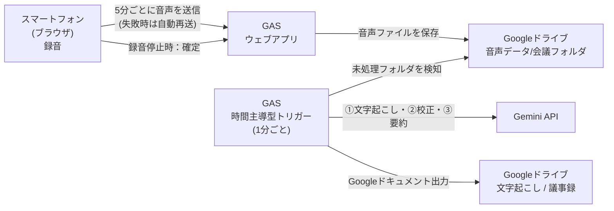

# らくらく議事録

会議をスマートフォンで録音するだけで、**文字起こし・議事録の作成・Googleドライブへの保存**までを自動で行う Web アプリです。
介護施設での会議（生産性向上委員会、サービス担当者会議、苦情・要望の受付など）で使うことを想定して作られています。

> 開発：Effortless Care DX
> © 2026 Effortless Care DX

---

## 特長

- **録音を止めたら、アプリを閉じてよい**
  録音停止後は音声の保存を確定するだけです。文字起こし・全文校正・議事録の作成は、Google Apps Script（GAS）のトリガーがバックグラウンドで自動処理します。
- **長時間の会議に対応（3段階の自動引き継ぎ設計）**
  録音を一定時間（既定は5分）ごとのファイルに分けて、Googleドライブへ順に保存します。30分〜数時間の会議でも、GAS の実行時間制限（6分）を超えないよう、**「①ファイル別の文字起こし → ②全文のAI校正 → ③文字起こし・議事録ドキュメントの作成」**を段階的に保存しながら次回のトリガー実行へ安全に引き継ぎます。
- **録音中のカレンダー確認など、他アプリへの一時切り替えに対応**
  OS 標準のハードウェア音声処理（エコーキャンセラ・ノイズ抑制・オートゲインコントロール）を適用したマイクストリームを録音エンジンに直結し、他アプリ表示中は5分分割を一時待機させることで、**録音中にカレンダーやメールなどを確認しても録音が無音化・停止しない設計**になっています。
- **リアルタイム音声波形と省電力モニター表示**
  マイクが声を拾っていることを視覚的に確認できる「オーディオ・コア（波形リング）」と「12バンド・スペクトラム波形」を搭載しています。録音開始後は自動で暗色（スタジオダークモード）に切り替わり、さらに30秒操作がないと画面を暗転させる「省電力スリープ（疑似スリープ）表示」と画面スリープ防止（Wake Lock）が働きます。
- **用途別の議事録テンプレートを3種類用意**
  汎用議事録 / サービス担当者会議録（第4表） / 苦情・要望等受付
- **通信エラーや途中停止に強い自動復旧・再開機能**
  - **フロントエンド側**：録音データを1秒ごとにメモリへ退避し、一時的な電波不良や画面切り替えで送信できなかった音声データは「未送信キュー」に保持して画面復帰時や停止時に自動で再送します。
  - **バックエンド側**：進捗は `_progress.json` および `_corrected_transcript.txt` に保存され、API の一時的な制限（HTTP 429 / 500 / 503）発生時も指数バックオフで自動リトライします。
- **診断情報の表示**
  通信エラーや処理結果（`finishReason`・トークン数・使用モデルなど）をアプリ内で確認し、ワンタップでコピーして管理者に共有できます。

---

## 全体の仕組み



### Googleドライブに作られるフォルダ構成

指定した親フォルダの直下に、次の3つのフォルダが自動で作られます。

```text
（親フォルダ）
├── 音声データ/
│   ├── 20261019_1000_生産性向上委員会/          ← 録音中〜処理待ち
│   │   ├── 001_音声.webm (iPhone環境等では .mp4)
│   │   ├── 002_音声.webm
│   │   ├── _progress.json                       ← 処理中の進捗（完了後に自動削除）
│   │   └── _corrected_transcript.txt            ← AI校正済み全文（完了後に自動削除）
│   └── 【済】20261019_1000_生産性向上委員会/    ← 処理完了後（自動で名前が変わる）
├── 文字起こし/
│   └── 20261019_1000_生産性向上委員会_文字起こし（Googleドキュメント）
└── 議事録/
    └── 20261019_1000_生産性向上委員会_議事録（Googleドキュメント）
```

> **補足**：録音中に画面上で会議名を変更した場合、確定（停止）時に Google ドライブ上の会議フォルダ名も新しい会議名へ自動でリネームされます。

---

## 動作環境

| 項目 | 内容 |
| --- | --- |
| 対応端末・ブラウザ | **iPhone / iPad（iOS Safari）**、**Android スマートフォン（Chrome）**、PC（Chrome / Edge / Safari） |
| 録音形式 | `audio/webm;codecs=opus`（非対応環境では `audio/mp4` → `audio/webm` → `audio/aac` → ブラウザ既定の順に自動選択） |
| 会議名の音声入力 | Web Speech API（`webkitSpeechRecognition` / `SpeechRecognition`）対応ブラウザ |
| 画面スリープ防止 | Screen Wake Lock API 対応ブラウザ + 無音オーディオ再生による iOS バックグラウンド維持 |
| バックエンド | Google Apps Script（Googleドライブ / Googleドキュメント / UrlFetchApp / LockService / PropertiesService） |
| 使用 AI API | Google Gemini API（`v1beta`） |

### 録音中の他アプリ操作・画面表示について

- **カレンダーやメール等の確認（一時的なアプリ切り替え）**：
  録音中にホーム画面へ戻ったり、カレンダー・メモ帳などの**マイクを使用しない別アプリ**へ一時的に切り替えても、録音は継続されます。バックグラウンド滞在中に5分経過した場合は分割処理を一時保留し、ブラウザ画面に戻った時点で安全に区切って送信します。
- **長時間の放置時**：
  モバイル OS の仕様上、画面ロック（電源ボタンOFF）や別アプリを開いたまま長時間経過すると、OS の省電力機能によりブラウザ自体が強制終了される場合があります。日程確認などが終わったら本アプリの画面に戻し、**画面を開いたまま（30秒後に自動で省電力スリープ画面になります）机に置いておく運用**を推奨します。

---

## セットアップ手順

### 1. Googleドライブの親フォルダを用意する

1. Googleドライブで、議事録一式を保存したいフォルダを1つ作成します（例：`らくらく議事録_データ`）。
2. そのフォルダを開き、ブラウザのアドレスバーから **フォルダID**（`/folders/` の後ろの英数字列）を控え、`コード.gs` 冒頭の `PARENT_FOLDER_ID` に設定します。

### 2. Gemini API キーを取得する

1. [Google AI Studio](https://aistudio.google.com/) で Gemini API キーを発行します。

### 3. Google Apps Script プロジェクトを作成する

1. [script.google.com](https://script.google.com/) で新しいプロジェクトを作成します。
2. `コード.gs` にバックエンドのコードを貼り付け、`PARENT_FOLDER_ID` を自分のフォルダIDに書き換えます。
3. GAS 自身から HTML も配信する場合は、`index.html` という名前で HTML ファイルを追加し、フロントエンドのコードを貼り付けます（GitHub Pages 等の外部ホスティングを使う場合は不要です）。

### 4. スクリプトプロパティを設定する

GAS エディタの左メニュー「**プロジェクトの設定**（歯車アイコン）」→「**スクリプト プロパティ**」で、以下を追加します。

| プロパティ名 | 必須 | 設定値の例 | 説明 |
| --- | --- | --- | --- |
| `GEMINI_API_KEY` | **必須** | `AIzaSy...` | Gemini API キー |
| `GEMINI_TRANSCRIBE_MODEL` | 任意 | `gemini-3.8-flash` | 文字起こし・全文校正に使うモデル名（未設定時の既定値：`gemini-3.8-flash`） |
| `GEMINI_MINUTES_MODEL` | 任意 | `gemini-3.8-flash` | 議事録の作成に使うモデル名（未設定時の既定値：`gemini-3.8-flash`） |

> **モデルの切り替えについて**
> 新しい Gemini モデルが出たときは、コードを変更せずスクリプトプロパティの値だけを書き換えれば切り替えられます。`transcribe` を含むモデル名（`gemini-3.5-transcribe` など）を指定した場合は、文字起こしステップのみ自動で Interactions API 形式に切り替わります。

### 5. ウェブアプリとしてデプロイする

1. GAS エディタ右上の「**デプロイ**」→「**新しいデプロイ**」を開きます。
2. 種類で「**ウェブアプリ**」を選択します。
3. 次の設定でデプロイします。
   - **次のユーザーとして実行**：「自分」
   - **アクセスできるユーザー**：「全員」
4. 発行された **ウェブアプリの URL（`https://script.google.com/macros/s/.../exec`）** を控えます。
5. `index.html` 内の定数 `GAS_URL` に、この URL を設定します。

### 6. 時間主導型トリガーを設定する（重要）

バックグラウンドで文字起こしと議事録作成を自動実行するため、GAS のトリガーを必ず設定してください。

1. GAS エディタ左メニューの「**トリガー**（時計アイコン）」を開きます。
2. 右下の「**トリガーを追加**」を押し、次のように設定して保存します。
   - **実行する関数を選択**：`processQueueTrigger`
   - **実行するデプロイを選択**：`Head`
   - **イベントのソースを選択**：`時間主導型`
   - **時間ベースのトリガーのタイプ**：`分ベースのタイマー`
   - **時間の間隔**：`1分おき`（または `5分おき`）

> `LockService` により多重起動は自動で防がれるため、`1分おき` に設定しても同じ会議が二重に処理されることはありません。また、長い会議でステップ分割が発生した際も、1分おきであればスムーズに後続ステップへ引き継がれます。

---

## 使い方

### 1. 会議の種類（テンプレート）を選ぶ

画面上部の「**会議の種類（議事録フォーマット）**」から、用途に合わせて選びます。

| 選択肢 | 作られる議事録の内容 |
| --- | --- |
| **汎用議事録（委員会・会議など）** | 日時・場所・出席者、議題、決定事項、話し合いの内容（発言者ごと）、今後の宿題（ToDo） |
| **サービス担当者会議録（第4表）** | 利用者名・ケアマネジャー名、開催日時・場所、出席者（所属・職種）、検討した項目、検討内容（発言者・職種ごと）、結論（サービス内容・頻度・期間・役割分担）、残された課題・次回開催時期 |
| **苦情・要望等受付（聞き取り・対応）** | 受付日時・場所・方法、申立人・対象利用者・受付担当者、苦情・要望の具体的内容、事実確認の結果・原因分析、申立人への説明と反応、改善策・再発防止策、今後の対応予定 |

### 2. 会議名を入力する

- 「**会議名**」欄に会議の名前を入力します（例：`生産性向上委員会`、`佐藤様_担当者会議`）。
- 右側の **マイク入力ボタン** を押すと、声で会議名を入力できます（録音開始前のみ使用可能）。
- 空欄のまま録音を開始した場合は、自動的に `会議録音` という名前になります。
- **録音開始後に会議名を書き換えた場合も、停止（保存確定）時に変更後の名前がドライブのフォルダ名・ドキュメント名に反映されます。**

### 3. 録音を開始する

1. 中央の **録音ボタン（マイクアイコン）** を押します。
2. 初回のみマイクの使用許可を求められるので「許可」を選びます。
3. 録音が始まると、以下の状態に切り替わります。
   - 画面全体が省電力の**スタジオダークモード**に切り替わり、上部のバッジが `LIVE REC` になります。
   - 声の大きさや周波数に合わせて、中央の**オーディオ・コア（波形リング）**と**12バンド・スペクトラム波形**がリアルタイムに動きます（マイクが正常に音を拾っている目印になります）。
   - 5分ごとに音声データが自動で Googleドライブへバックアップ送信され、下部のインジケーター（緑色のドット）に状況が表示されます。
   - 30秒間画面に触れないと、バッテリー消費と画面焼き付きを抑えるため**省電力スリープ（疑似スリープ）画面**に切り替わります。画面のどこかをタップすると元の画面に戻ります。

### 4. 録音を停止する

1. 会議が終わったら（省電力スリープ表示中は一度画面をタップして復帰させてから）、中央の **停止ボタン（四角アイコン）** を押します。
2. 最後の音声データ（および未送信のバックアップデータがある場合はそのデータ）の送信と保存確定が行われます（バッジが `SAVING` になります）。
3. 「**録音データの保存が完了しました！この画面は閉じて構いません。**」と表示されたら、ブラウザを閉じて終了です。

### 5. 出来上がった議事録を確認する

- 数分〜十数分後、Googleドライブの「**文字起こし**」フォルダと「**議事録**」フォルダに Googleドキュメントが作成されます。
- アプリ画面下部の「**ドライブを開く**」リンク、または画面右上のメニューボタンから開ける「**ドライブの保存先を開く**」から直接アクセスできます。

### 6. テスト接続・診断ログの確認（右上メニュー）

画面右上のメニューボタンから、以下の保守機能を利用できます。

- **ドライブの保存先を開く**：保存先の Googleドライブ親フォルダを新しいタブで開きます。
- **AIテスト接続（疎通確認）**：録音を行わずに GAS と Gemini API の疎通テストを実行し、現在設定されているモデル名や応答状況を確認できます。
- **診断ログを表示**：直近の通信結果やエラー詳細を確認・コピーできます。

---

## 処理の流れ（詳細）

### 録音中〜停止時（フロントエンド ⇄ GAS `doPost`）

1. **セッション開始（初回送信時）**
   最初の音声データ送信時に `folderId` が未取得であれば、GAS 側で `音声データ/YYYYMMDD_HHmm_会議名` フォルダを自動作成し、`folderId` をブラウザへ返します。
2. **分割保存（`appendAudioChunk`）**
   5分ごとに録音データを Base64 形式で GAS へ送信し、`001_音声.webm`、`002_音声.webm` …（3桁ゼロ埋め連番）として保存します。GAS 側では `LockService` により並列送信時のファイル番号の重複を防止しています。
   ※他アプリ表示中に5分に達した場合は分割を待機し、画面に戻ったタイミングで即座に区切って送信します。
3. **確定（`finalizeSession`）**
   停止ボタンが押されると、残りの音声データをすべて送信し終えたあと、`finalizeSession` アクションを送ります。会議名が途中で変更されていた場合はフォルダ名を更新し、フォルダの説明欄（Description）にメタデータ（`status: "QUEUED"`、会議名、テンプレート種別、録音日時、リトライ回数 `0`）を書き込みます。

### バックグラウンド処理（GAS `processQueueTrigger`）

1分ごとに動くトリガーが `音声データ/` 内の未処理フォルダ（`status: "QUEUED"`）を見つけ、以下の **3ステップ** で処理します。GAS の 6分制限を確実に回避するため、残り時間に応じて自動的に次回トリガーへバトンタッチします。

1. **Step 1：ファイル別の文字起こし（`handleTranscribeFromAudioFile`）**
   - フォルダ内の音声ファイルを名前順（`001` → `002` → …）に1件ずつ処理します。
   - 各ファイルを Gemini Files API（`/upload/v1beta/files`）へアップロードし、`ACTIVE` 状態になるのを待ってから文字起こしを実行します。完了後、Gemini 上の一時ファイルは即時削除されます。
   - **1ファイル完了するごとに、結果を `_progress.json` に保存します。**
   - 処理開始から **3分30秒（`TIME_LIMIT_MS`）** を超えていた場合は、残りのファイルを次回トリガーに回して安全に一旦終了します。
2. **Step 2：全文結合と AI 校正（`refineTranscriptWithGemini`）**
   - 全ファイルの文字起こしが揃ったら、経過時間をチェックします。すでに **2分30秒（`STEP2_SAFE_TIME_LIMIT_MS`）** を超えている場合は、Step 2 の途中でタイムアウトするのを防ぐため、一旦終了して次回トリガー（残り6分フルの状態）で Step 2 から再開します。
   - 前後の文脈から同音異義語や介護専門用語の誤変換・フィラーを整え、結果を **`_corrected_transcript.txt` にキャッシュ保存**します。
   - 万が一、長文会議で AI の出力上限（`MAX_TOKENS`）に達したり文字数が70%未満に欠落した場合は、安全ガードが働き、**欠落のない「Step 1 の単純結合テキスト」へ自動でフォールバック**します。
3. **Step 3：ドキュメント作成と完了処理**
   - まず **`文字起こし/` フォルダに文字起こし Googleドキュメントを作成（同名ファイルがある場合は上書き更新）** します。これにより、後続の議事録生成でエラーが起きても文字起こし全文は確実に手元に残ります。
   - 続いて、選択されたテンプレートに応じたプロンプトで議事録を生成し、**`議事録/` フォルダに議事録 Googleドキュメントを作成**します。
   - 最後に、音声フォルダの先頭に `【済】` を付け、ステータスを `COMPLETED` に更新し、一時ファイル（`_progress.json` と `_corrected_transcript.txt`）を削除して完了します。

---

## 主な設定値（コード内の定数）

運用に合わせて変更できる主な定数です。

### `コード.gs`

| 定数名 | 既定値 | 説明 |
| --- | --- | --- |
| `PARENT_FOLDER_ID` | `""` | Googleドライブの親フォルダID（**要設定**） |
| `DEFAULT_TRANSCRIBE_MODEL` | `"gemini-3.8-flash"` | スクリプトプロパティ未設定時の文字起こし・校正モデル |
| `DEFAULT_MINUTES_MODEL` | `"gemini-3.8-flash"` | スクリプトプロパティ未設定時の議事録生成モデル |
| `MAX_RETRY_COUNT` | `3` | トリガー処理でエラーが発生した際の最大リトライ回数（3回連続失敗で `【エラー】` フォルダに変更） |
| `TIME_LIMIT_MS` | `210000`（3分30秒） | Step 1（音声ファイル別文字起こし）で次のファイルに進むかの安全制限時間 |
| `STEP2_SAFE_TIME_LIMIT_MS` | `150000`（2分30秒） | Step 1 完了後、そのまま同一トリガー内で Step 2（全文校正）へ進むかの判定時間 |

### `index.html`

| 定数名 | 既定値 | 説明 |
| --- | --- | --- |
| `GAS_URL` | `"https://script.google.com/..."` | デプロイした GAS ウェブアプリの URL（**要設定**） |
| `DRIVE_FOLDER_URL` | `"https://drive.google.com/..."` | 「ドライブを開く」で開く Googleドライブのフォルダ URL（**要設定**） |
| `SEGMENT_DURATION_MS` | `300000`（5分） | 録音データを分割して自動送信する間隔（ミリ秒） |
| `IDLE_TIMEOUT_MS` | `30000`（30秒） | 録音中に省電力スリープ（疑似スリープ）表示へ入るまでの無操作時間 |

---

## トラブルシューティング

### いつまで経っても「文字起こし」「議事録」が作られない

1. **GAS のトリガーが設定されているか確認**
   GAS エディタの「トリガー」画面で、`processQueueTrigger` が時間主導型（1分おき等）で登録されているか確認してください。
2. **音声フォルダの名前を確認**
   - フォルダ名の先頭に `【エラー】` が付いている場合は、3回連続でエラーが発生し自動処理が停止しています。
   - GAS エディタの「**実行数**」メニューから `processQueueTrigger` のエラーログを確認してください。
3. **最初から処理をやり直したいとき**
   - 対象フォルダの名前から `【エラー】` や `【済】` を消します。
   - 最初から完全にやり直したい場合は、フォルダ内にある `_progress.json` や `_corrected_transcript.txt` を削除します（残しておけば、完了済みのステップをスキップして途中から再開します）。
   - Googleドライブでそのフォルダを右クリック →「**フォルダ情報**」→「**説明**」欄にある JSON の `"status"` を `"QUEUED"`、`"retryCount"` を `0` に書き換えると、次のトリガー実行時に再処理されます（既存の同名ドキュメントがある場合は重複せず自動で上書き更新されます）。

### 「AIテスト接続」でエラーが出る

- **`GEMINI_API_KEY が設定されていません`**：GAS の「プロジェクトの設定」→「スクリプト プロパティ」に `GEMINI_API_KEY` を登録してください。
- **`404` / モデルが見つからないエラー**：スクリプトプロパティ `GEMINI_TRANSCRIBE_MODEL` / `GEMINI_MINUTES_MODEL` に指定しているモデル名に誤字がないか確認してください。
- **設定を変えたのに反映されない**：GAS のコードを書き換えた場合は、「デプロイ」→「デプロイを管理」→ 鉛筆アイコン → バージョンを「**新バージョン**」にして更新してください（※スクリプトプロパティの変更のみであれば再デプロイは不要です）。

### iPhone / スマートフォンでマイクが音を拾わない・波形が動かない

- 録音開始直後に中央の波形（オーディオ・コア／スペクトラムバー）が声に反応して動くか確認してください。
- iPhone（iOS Safari）では、他アプリから戻った際などに OS 側でマイクトラックが一時停止された場合でも、アプリが自動検知してマイクストリームの再接続を試みます。
- ブラウザのマイク権限が拒否されている場合は、端末の設定（iPhone の場合は「設定」→「アプリ」→「Safari」→「マイク」、Android の場合はアドレスバー左のアイコン）からマイクを「許可」に変更してページを再読み込みしてください。

---

## 既知の制限と注意点

- **電話の着信や、マイクを使う別アプリ（通話・カメラ・音声入力など）の起動**
  録音中に電話を着信したり、マイクを使用する他のアプリを開いた場合は、スマートフォンの OS 仕様によりマイクの権限がそちらへ奪われ、録音が中断されることがあります。ただし、本アプリは録音データを **1秒ごとにメモリへ退避**しているため、万が一途中で中断・停止した場合でも、**中断直前までの音声データは失われずに Googleドライブへ送信**されます。
- **長時間の画面ロック（電源ボタンOFF）について**
  カレンダー確認などの一時的なアプリ切り替えには対応していますが、スマートフォンの電源ボタンを押して画面を完全にロックしたまま何十分も放置すると、OS のメモリ管理によりブラウザのタブ自体が休止される場合があります。会議中は電源ボタンを押さず、アプリ画面を開いたまま（30秒後に自動で暗転する省電力スリープ画面の状態で）置いておくことを推奨します。
- **電波が不安定な場所での利用**
  会議室の電波が一時的に悪く5分ごとの送信に失敗した場合でも、録音は止まらずに未送信データがアプリ内の再送キュー（`pendingRetrySegments`）に保持され、電波復帰時や録音停止時にまとめて再送されます。停止ボタンを押した際は、「保存が完了しました」と表示されるまでブラウザを閉じずにお待ちください。

---

## ファイル構成

| ファイル | 役割 |
| --- | --- |
| `index.html` | フロントエンド（UI、リアルタイム音声波形、録音・分割送信・再送制御、他アプリ切り替え保護、省電力スリープ、音声入力、診断ログ表示） |
| `コード.gs` | バックエンド（Googleドライブへの保存、3段階タイムアウト回避・進捗管理、Gemini API 連携、Googleドキュメント作成・上書き制御） |
| `README.md` | 本ドキュメント |
